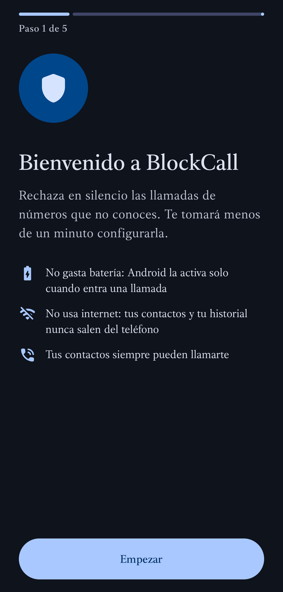
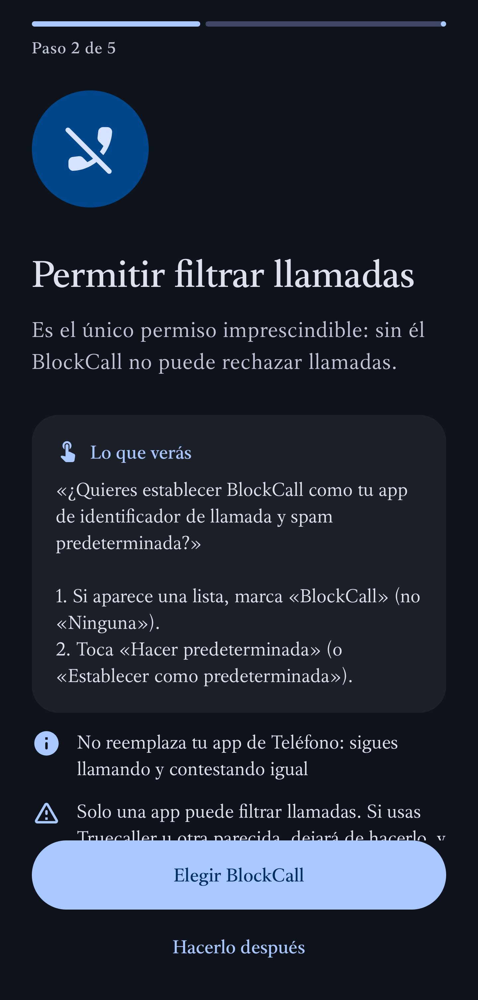
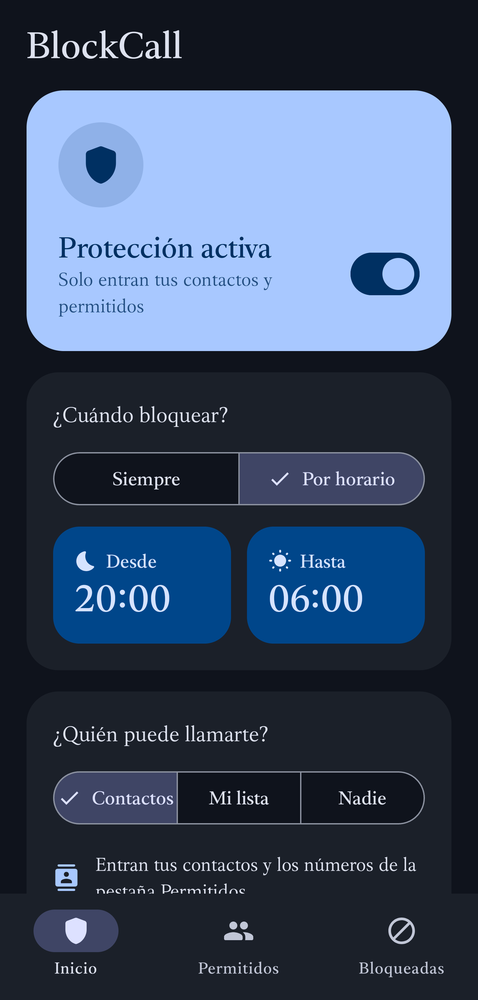
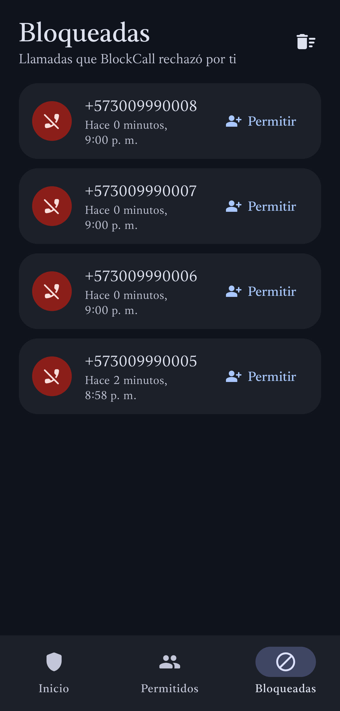

# BlockCall

[English](README.md) · **Español**

App Android (10+) que rechaza en silencio las llamadas entrantes de números que no están en tus contactos ni en tu lista de permitidos. Disponible en español e inglés.

[**⬇ Descargar el último APK**](https://github.com/cmonroyp/BlockCall/releases/latest) · Licencia: [GPL-3.0](LICENSE)

<p>
  
  
  
  
</p>

## Funciones
- **¿Quién puede llamarte?** *Contactos* (contactos + Permitidos), *Mi lista* (solo Permitidos) o *Nadie*.
- Activa siempre o por horario (también cruzando la medianoche, p. ej. 20:00–06:00).
- Números ocultos o privados: bloqueados.
- **Permitir si insiste**: si el mismo número llama 2 veces en menos de 3 minutos, la segunda entra.
- Historial de bloqueadas, un único aviso silencioso, tema claro/oscuro.
- Asistente al primer inicio que explica cada aviso de permisos de Android.

## Cómo funciona
- Usa la API oficial `CallScreeningService`. Android activa la app **solo** cuando entra una llamada, decide en milisegundos y la libera. No hay nada en segundo plano: no gasta batería y ningún limpiador de tareas la detiene.
- **Sin permiso de internet**, sin anuncios ni rastreadores: tus contactos y tu historial nunca salen del teléfono.
- Si algo falla (o falta el acceso a contactos), la llamada **entra**.
- Android siempre deja las llamadas filtradas en el historial del teléfono como "bloqueadas".

## Instalación
1. Descarga el APK de [Releases](https://github.com/cmonroyp/BlockCall/releases) y ábrelo en el celular (permite "instalar apps de origen desconocido" si te lo pide).
   Con [Obtainium](https://github.com/ImranR98/Obtainium) recibes las actualizaciones automáticamente: *Agregar app* → `https://github.com/cmonroyp/BlockCall`.
2. Abre BlockCall y sigue el asistente:
   - **Filtro de llamadas**: en la lista marca **BlockCall** (no "Ninguna") y toca **Hacer predeterminada**. No reemplaza tu app de Teléfono. Solo una app puede tener este permiso (Truecaller, por ejemplo, dejará de filtrar).
   - **Contactos** y **notificaciones**: toca **Permitir**.
   - Xiaomi / Redmi / POCO / vivo / Huawei / Honor: activa **Inicio automático** (el asistente abre esa pantalla).

Para actualizar, instala el APK nuevo encima: conserva la configuración.

## Compilar
```bash
./gradlew :app:assembleRelease
```
La firma de release se lee de `keystore.properties` (no está en el repositorio); sin él, el APK sale sin firmar.

## Probar sin llamadas reales
El módulo `callsim` (solo para pruebas) inyecta llamadas entrantes falsas por ADB; los comandos están en el [README en inglés](README.md#test-without-real-calls).

## Licencia
[GPL-3.0](LICENSE). Notas para publicar en tiendas: [distribution/](distribution/README.md).
