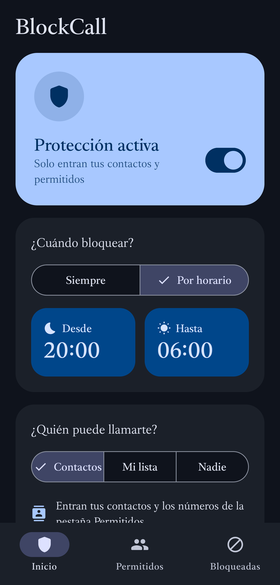

# BlockCall

**English** · [Español](README.es.md)

Android app (10+) that silently rejects incoming calls from numbers that aren't in your contacts or on your allowed list. Available in English and Spanish.

[**⬇ Download the latest APK**](https://github.com/cmonroyp/BlockCall/releases/latest) · License: [GPL-3.0](LICENSE)

<p>
  
  
  
  
</p>

## Features
- **Who can call you?** *Contacts* (contacts + Allowed list), *My list* (Allowed list only) or *Nobody*.
- Always on, or on a schedule (across midnight too, e.g. 20:00–06:00).
- Hidden or private numbers are blocked.
- **Allow if they insist**: if the same number calls twice within 3 minutes, the second call rings.
- History of blocked calls, a single silent notification, light/dark theme.
- First-run assistant that explains each Android permission prompt.

## How it works
- Uses Android's official `CallScreeningService`. The system wakes the app **only** when a call arrives, it decides in milliseconds and is released. Nothing runs in the background: no battery drain, and task killers can't stop it.
- **No internet permission**, no ads, no trackers: your contacts and history never leave the phone.
- If anything fails (or contacts access is missing), the call **goes through**.
- Android always records screened calls in the phone's call log as "blocked".

## Install
1. Download the APK from [Releases](https://github.com/cmonroyp/BlockCall/releases) and open it on your phone (allow "install unknown apps" if asked).
   With [Obtainium](https://github.com/ImranR98/Obtainium) you get updates automatically: *Add app* → `https://github.com/cmonroyp/BlockCall`.
2. Open BlockCall and follow the assistant:
   - **Call screening**: select **BlockCall** in the list (not "None") and tap **Set as default**. It doesn't replace your Phone app. Only one app can hold this role (e.g. Truecaller will stop screening).
   - **Contacts** and **notifications**: tap **Allow**.
   - Xiaomi / Redmi / POCO / vivo / Huawei / Honor: enable **Autostart** (the assistant opens that screen).

To update, install the new APK over the old one: your settings are kept.

## Build
```bash
./gradlew :app:assembleRelease
```
Release signing reads `keystore.properties` (not in the repo); without it the APK is built unsigned.

## Test without real calls
The `callsim` module (testing only) injects fake incoming calls via ADB:
```bash
./gradlew :callsim:assembleDebug
adb install callsim/build/outputs/apk/debug/callsim-debug.apk
adb shell am broadcast -n com.blockcall.callsim/.TriggerReceiver -a register
adb shell telecom set-phone-account-enabled com.blockcall.callsim/.SimConnectionService sim 0
adb shell am broadcast -n com.blockcall.callsim/.TriggerReceiver -a call --es number +15550100
adb logcat -s BlockCall
```
Uninstall it when done (`adb uninstall com.blockcall.callsim`).

## License
[GPL-3.0](LICENSE). Distribution notes for app stores: [distribution/](distribution/README.md).
